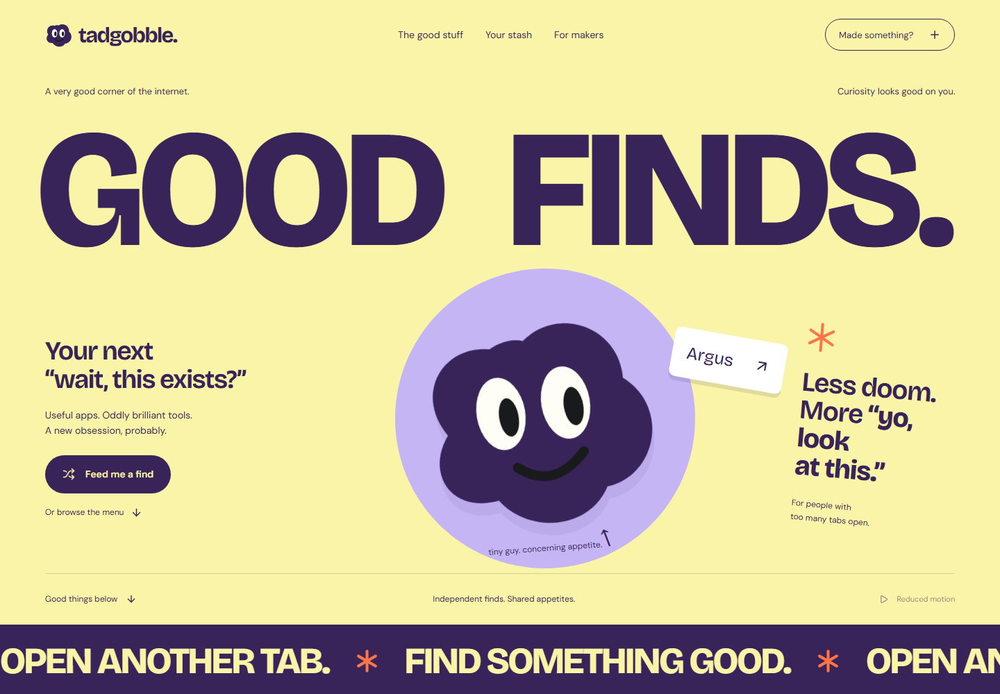

# tadgobble

**Good finds. Questionable screen time.**

A playful place to discover useful apps, oddly brilliant tools, and your next “wait, this exists?” Find something worth opening, save it for later, or give your own product a place on the menu.

Meet Gobble: the purple blob with excellent taste and absolutely no tab discipline.



## What's inside

- **Explore the good stuff.** Colorful product drawers, real website previews, search, 22 categories, and 8 audience choices.
- **Keep a stash.** Accounts, saved finds, product pages, and conversations around each discovery.
- **Launch something.** A four-step maker submission flow with a live listing preview, pricing and platform choices, and optional context.
- **Show the actual product.** Automatic website screenshots, custom cover uploads, retake/remove controls, and a graceful fallback when a site cannot be captured.
- **Review before publishing.** An admin studio for checking submissions, managing covers, and approving listings. Pending products and their images stay private.
- **A little personality.** Gobble boops, playful motion, expressive typography, mobile layouts, keyboard controls, and reduced-motion support.
- **An optional content kitchen.** Prepare scripts and captions, render portrait videos from authorised demos, review them, and schedule them. The Instagram integration is disabled until configured.

## Run it locally

The public build runs on **[tadgobble.web.app](https://tadgobble.web.app)** using Firebase Hosting and Supabase. [Free hosting setup](docs/FREE_HOSTING.md) covers deployment, Google sign-in, database migrations, and the desktop screenshot worker.

Use **Node.js 22.13+** and npm.

```bash
git clone https://github.com/gyanvadhel/tadgobble.git
cd tadgobble
npm ci
npx playwright install chromium
npm run setup
npm run dev
```

Open **http://127.0.0.1:3000**.

The setup script creates `.env.local` with a unique admin password and preserves existing configuration. Open that file locally for your admin login. Credentials, databases, uploads, and generated artifacts are excluded from Git.

| Page | Local URL |
| --- | --- |
| Landing page | http://127.0.0.1:3000 |
| Discoveries | http://127.0.0.1:3000/discover |
| Submit a product | http://127.0.0.1:3000/discover?submit=1 |
| Admin studio | http://127.0.0.1:3000/studio |
| Pending submissions | http://127.0.0.1:3000/studio?tab=products&status=pending |

New installations start with an **empty catalog**. Real submissions appear after approval. Optional editorial demo fixtures can be enabled on a fresh database with `SEED_CATALOG=true`; they are not partnerships or endorsements.

For a production build:

```bash
npm run build
npm start
```

On Linux, install the browser's system dependencies with `npx playwright install --with-deps chromium`.

## From a link to a discovery

1. A maker adds a name, website, and short description.
2. A website preview loads while they choose a category and audience.
3. They can replace the cover, choose a listing color, and add optional details.
4. They review the listing and send it to the kitchen.
5. An admin checks the product and publishes it to discoveries.

Covers accept JPG, PNG, or WebP up to 5 MB and are stored as 1600 × 1200 WebP images. Makers can retry, upload, or skip when a site blocks automated capture. Admins can update covers for existing listings too.

## Built with

| Layer | Tools |
| --- | --- |
| Application | Next.js 16, React 19, JavaScript |
| Interface | Custom CSS, GSAP, Lucide, original SVG Gobble |
| Typography | Self-hosted Bricolage Grotesque and DM Sans |
| Cloud data and accounts | Supabase Postgres, Auth with Google, private Storage, guarded database functions |
| Local data and accounts | SQLite, server-side sessions, salted scrypt password hashes |
| Public hosting | Firebase Hosting static export; no Firebase Functions or App Hosting |
| Website covers | Playwright Chromium and Sharp |
| Video workflow | FFmpeg and an optional Meta publishing adapter |
| Verification | Node's test runner and Playwright browser suites |

The current landing page keeps the purple SVG Gobble permanently visible. Earlier Three.js/R3F scene code remains in the project, but does not replace the landing mascot.

## Project map

```text
app/          Routes, page layouts, and styles
hosting/      Static cloud app sharing the same UI components
components/   Discovery UI, Gobble, submission flow, and admin studio
lib/          Database, authentication, captures, moderation, and content workflow
public/       Fonts, artwork, and social preview
scripts/      Setup, worker, asset helpers, and browser verification
tests/        Workflow, access-control, and cover-service tests
supabase/     Database migrations, auth configuration, legacy-login function
docs/         Design notes, operations guide, and verification history
```

Runtime state lives under `data/` and is never committed. Back up the entire directory, including the SQLite database, media, and covers.

## Checks

```bash
npm test
npm run build
npm run test:e2e
npm run test:launch
npm run test:submission
npm run test:covers
```

Browser suites use isolated databases and temporary accounts. They cover discovery, accounts, submissions, moderation, cover uploads/capture, responsive layouts, and the video workflow without publishing externally. The cover suite also captures example.com to exercise the real screenshot service. Reports and screenshots go to the ignored `test-results/` directory.

## Running beyond localhost

The public site has a **static Firebase Hosting build backed by Supabase**. Discovery, Google accounts, saves, comments, uploaded covers, submissions, and moderation run without your computer. Automatic website screenshots use the desktop worker; queued captures wait while it is offline. See [Free hosting setup](docs/FREE_HOSTING.md).

The original local version also remains available as one Node application and an optional worker sharing a persistent disk. Use HTTPS and persistent storage if deploying that version elsewhere; an ephemeral filesystem will not preserve its SQLite database or uploaded files.

For the optional render/publishing worker:

```bash
npm run worker
```

External publishing stays off by default. A real Instagram connection needs configured credentials, suitable account access, publicly reachable approved media, and a publishing test. Cloud signups use Google, and Supabase email confirmation stays enabled. Email delivery/password recovery needs a custom SMTP service and a recovery UI before being offered publicly. Payments and subscription billing are not implemented.

## More about the project

- [Free hosting setup](docs/FREE_HOSTING.md) — Firebase, Supabase, Google sign-in, and cloud operations.
- [Operations and configuration](docs/OPERATIONS.md) — environment variables, covers, video workflow, Instagram setup, backups, and deployment considerations.
- [Brand notes](docs/BRAND.md) — Gobble, the voice, and the visual identity.
- [Submission design](docs/SUBMISSION_DESIGN.md) — the launch kitchen and cover experience.
- [Design direction](docs/DESIGN_DIRECTION.md) — references and layout decisions.
- [Verification history](docs/LAUNCH_QA.md) — completed checks and visual reviews.
- [Operating plan](docs/OPERATING_PLAN.md) — ideas for the community, content, and business.

Font licenses are included in `public/fonts/`.
